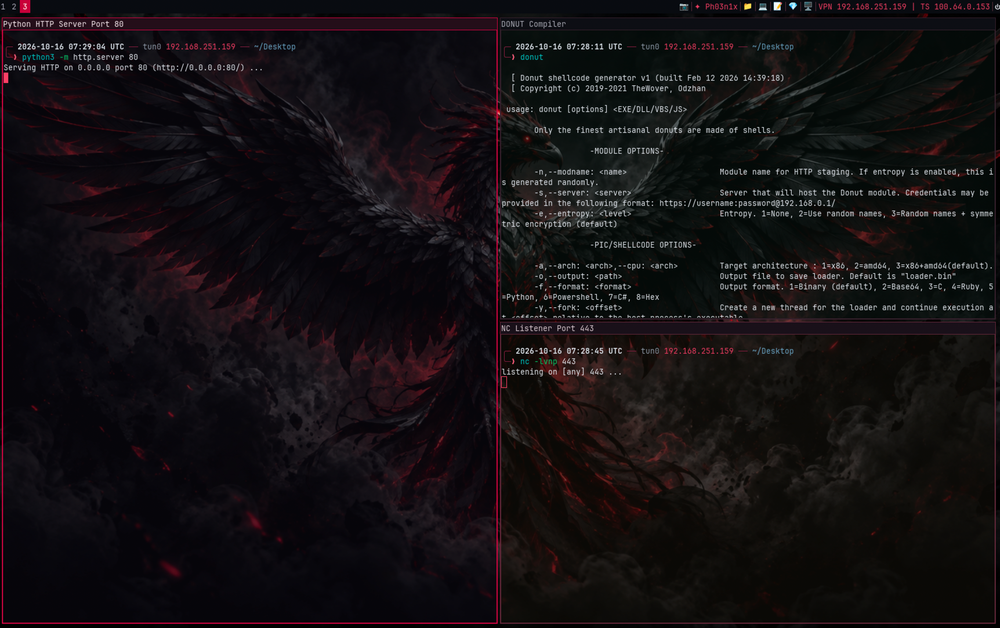
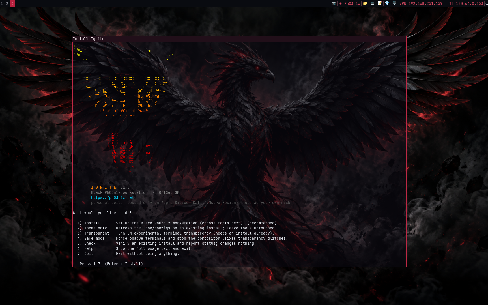
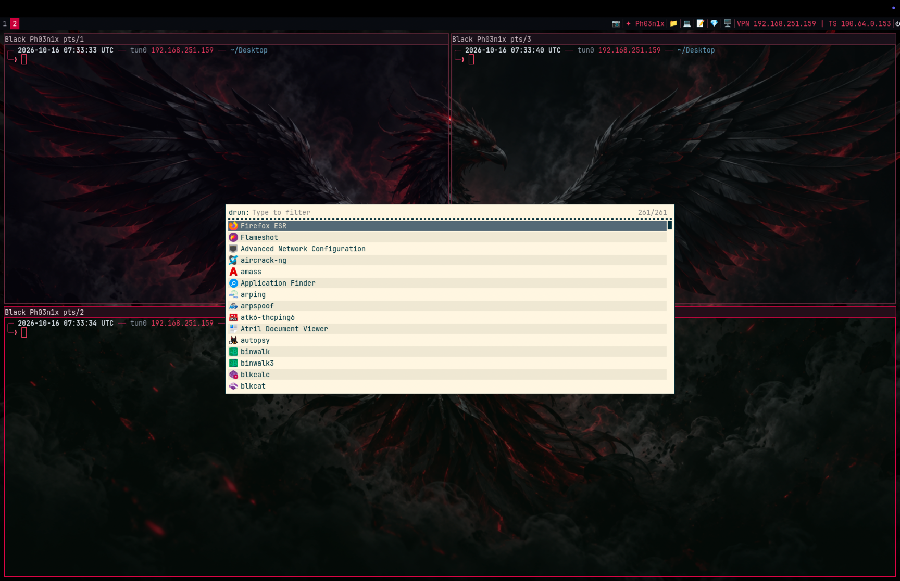
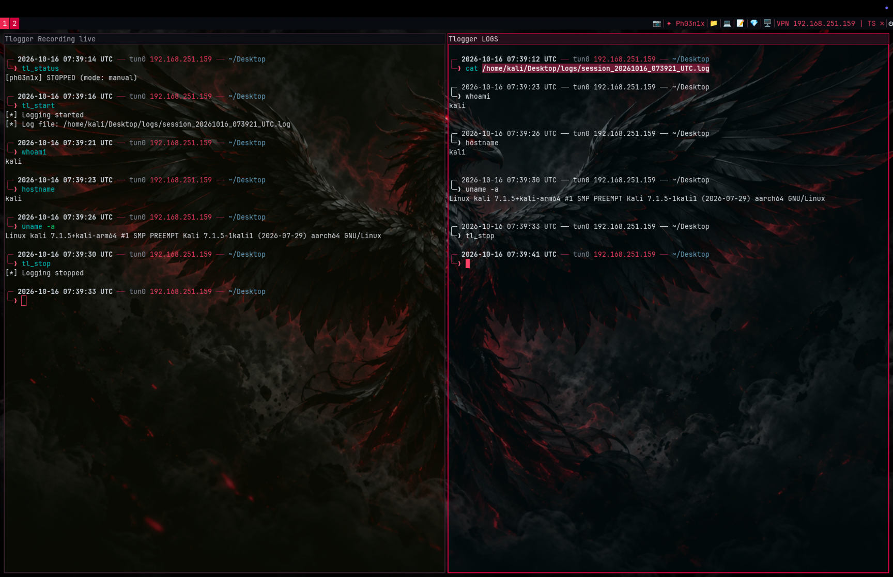
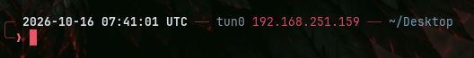
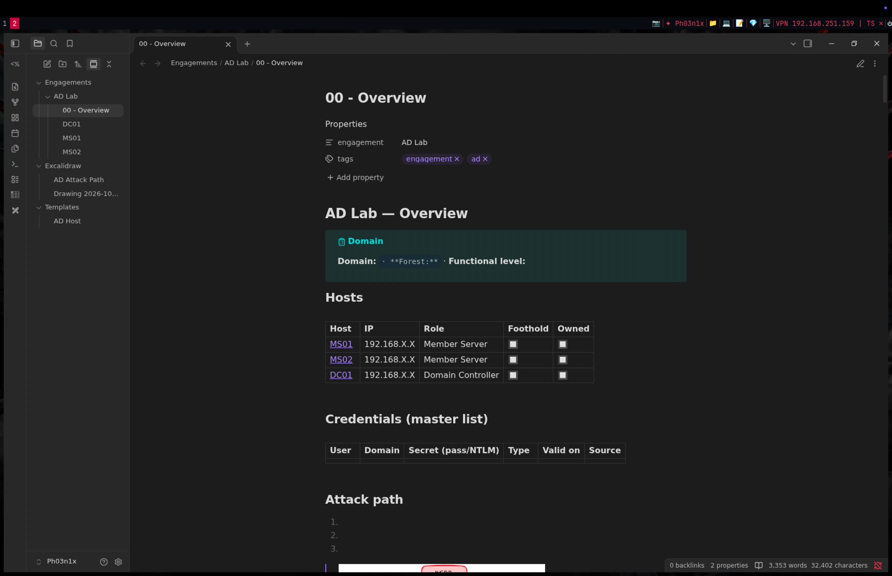
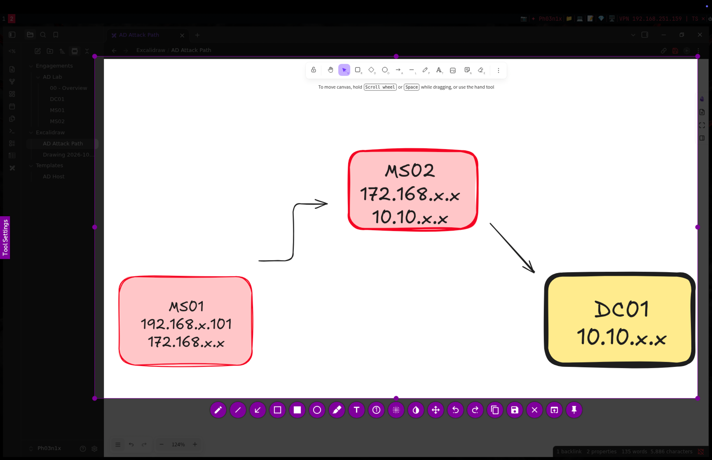
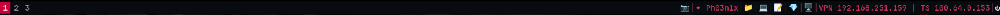
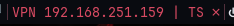

# [Black Ph03n1x](https://ph03n1x.net) — Ignite (read more details on my blog -> https://ph03n1x.net)

"The way I run my Kali box. Tiling i3 desktop with ARM64-patched tools, built for [OffSec](https://portal.offsec.com) students on Apple Silicon which I saw struggled specially with flameshot (patched it), Veil and Shellter (created a way to install them without issues), new TLoggerV3.1 that helps in Offsec exams. Created specially for [PEN-200](https://www.offsec.com/courses/pen-200/), but along the way patched it for more Offsec courses also where different tools don't behave properly"


## Screenshots

### Desktop


### Installer


### Rofi launcher


### TLoggerV3.1


### Zsh prompt


### Obsidian vault & template


### Flameshot


### The bar


### VPN block


## What it does

- **i3 desktop** — tiling WM, i3blocks status bar, rofi launcher, picom compositor, 60% transparent terminals
- **Custom prompt** — two-line zsh prompt with UTC timestamp and tun0 address (for report screenshots)
- **Flameshot** — bound to Print key and a bar button for region/full-screen captures
- **Obsidian** — arm64 AppImage with a pre-built vault (`~/Documents/<username>`) containing an AD-engagement template and plugins (Dataview, Templater, Advanced Tables, Excalidraw, Kanban, Code Styler)
- **TLoggerV3.1** — terminal session logger that captures every command and its output to a clean, timestamped log under `~/Desktop/logs/`
- **Remmina** — RDP client with a bar button
- **VPN bar block** — shows both tun0 and tailscale0 IPs, left-click copies to clipboard
- **Donut** — shellcode-to-PE generator (amd64 via QEMU on arm64)
- **Veil + Shellter** — AV-evasion payload generators (optional, slow on arm64)
- **Extras** — VS Code OSS, mousepad, seclists, feroxbuster config, themed GTK, wallpaper

## Quick start

```bash
chmod +x ignite
./ignite
```
| Argument | Effect |
|------|--------|
| `--username NAME` | Set your username (default: `ph03n1x`) — used in Obsidian vault and TLoggerV3.1 messages |
| `--desktop-only` | Desktop + tools only, skip Donut and extras |
| `--no-tlogger` | Skip TLoggerV3.1 |
| `--no-obsidian` | Skip Obsidian |
| `--skip-veil` | Skip Veil + Shellter |
| `--theme-only` | Re-apply theme, prompt and bar without reinstalling tools |
| `--transparent` | Turn terminal transparency on |
| `--safe-mode` | Force opaque terminals, stop compositor |
| `--check` | Verify the install, change nothing |
| `--help` | Full usage + disclaimer |

NOTE -> Shellter has dependency of docker container with Veil, so marking Shellter to install will automatically install Veil also

## Requirements

- Kali Linux (tested on arm64 / Apple Silicon via VMware Fusion)
- Run as your normal user, not root (the script uses `sudo` where needed)
- Internet connection for package downloads

## After install

Log out and back into i3 to load the desktop

Run `./ignite --check` to verify everything installed correctly.

## TLoggerV3.1

| Command | What it does |
|---------|-------------|
| `tl_start` | Start logging this terminal |
| `tl_stop` | Stop logging |
| `tl_status` | Show state, mode, log path, size |
| `tl_auto` | Enable autostart + start now |

Logs are saved to `~/Desktop/logs/session_YYYYMMDD_HHMMSS_UTC.log`

## The bar

| Item | Action |
|------|--------|
| 📷 flameshot | Left = region capture, Right = full screen to clipboard |
| ✦ Ph03n1x | Label only |
| 📁 Files | Left = tiled, Shift+left or Right = floating |
| 💻 Code | VS Code OSS |
| 📝 Mousepad | Quick text editor |
| 💎 Obsidian | Opens the vault |
| 🖥 Remmina | RDP client |
| VPN · TS | tun0 + tailscale0 — left-click copies IP |
| 🔋 Battery | Charge level |
| ⏻ Power | Left = lock, Right = menu |

The VPN block shows both interfaces: `VPN 10.10.14.5 | TS 100.64.0.3` when both up, `VPN ✗ | TS ✗` when neither.

## Components

| Tool | Description |
|------|-------------|
| i3-wm + i3blocks | Tiling WM and status bar |
| rofi | App launcher / menus |
| xfce4-terminal | Themed, 60% opacity |
| thunar | File manager |
| picom | Compositor (transparency) |
| zsh | Custom two-line prompt |
| flameshot | Screenshots |
| code-oss | VS Code OSS |
| Obsidian | arm64 AppImage + vault |
| Remmina | RDP client |
| TLoggerV3.1 | Terminal session logger |
| seclists | Wordlists for recon/fuzzing |
| feh · dunst · lxappearance | Wallpaper, notifications, GTK theme |
| open-vm-tools-desktop | Fusion clipboard / resize |
| Donut CLI | Shellcode-to-PE (amd64 via QEMU) |

## Cheatsheets

Keys are written as they sit on a MacBook. **⌘** = Super/Mod4, **⌥** = Alt/Mod1, **⇧** = Shift, **⌃** = Control.

> Blocked keys: `⌘ + F` (Fusion fullscreen), `⌘ + V` (macOS Paste), `⌘ + Space` (Spotlight) — use the `⌃ + ⌥` alternatives instead.

Printable one-page references — print them or pull them up on a second screen for quick lookup.


